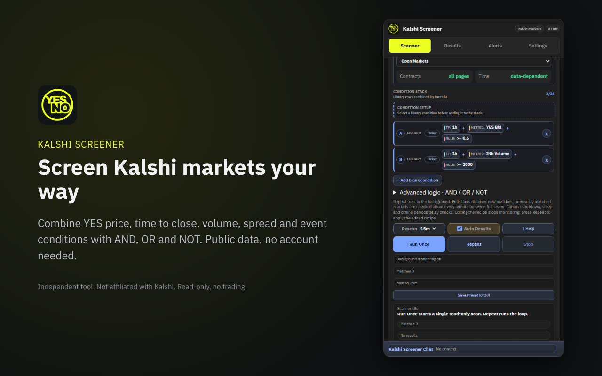
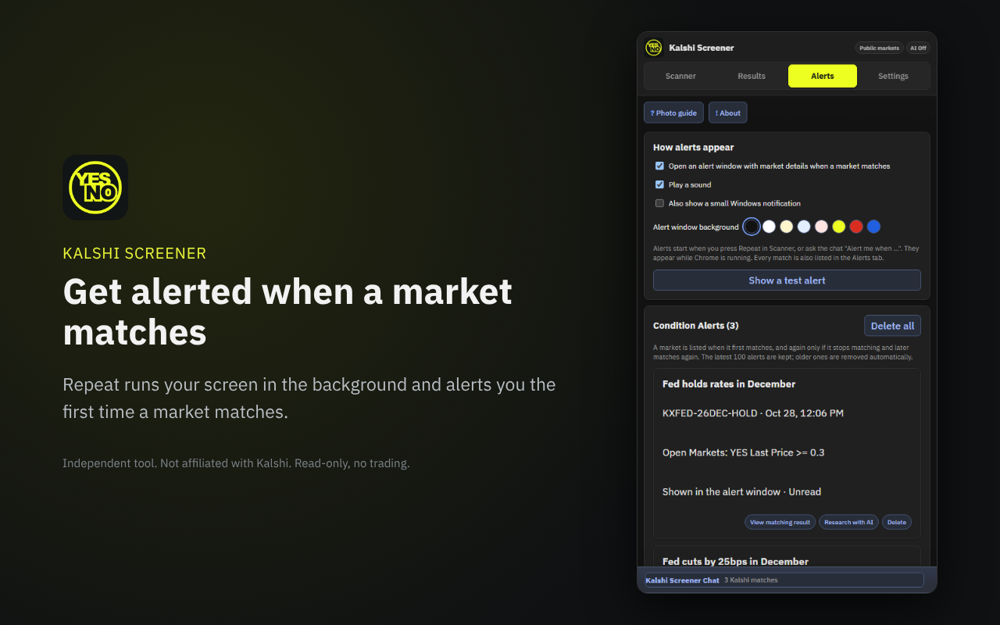
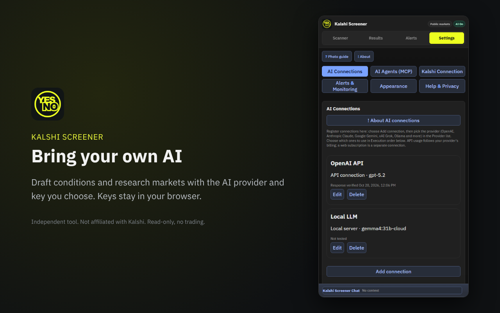

# Kalshi Screener: Chrome extension + MCP server

> **For research and education.** Kalshi Screener is a free, open-source, read-only tool. It never places trades, gives no buy or sell advice and is not financial advice. It is an independent project, not affiliated with, endorsed by or sponsored by Kalshi. Use it at your own risk.

Screen and monitor Kalshi prediction markets with your own conditions, get alerts when a market matches, and ask your AI about them.

| Scanner | Alerts | Bring your own AI |
|---|---|---|
|  |  |  |

This repository has two parts. Use either one or both.

- **Chrome extension** (`extension/`): a side panel that screens public market data, repeats your screen in the background and alerts you. No Kalshi account or API key needed.
- **MCP server** (everything else): lets Claude, ChatGPT, Cursor, VS Code and other AI apps search markets and read your saved conditions, watchlist and alerts.

No ads, no analytics, no hosted service. Everything runs on your computer (or your own Cloudflare account).

## Install the Chrome extension

The extension is not on the Chrome Web Store. Install it from this repository in developer mode:

1. Download **kalshi-screener-extension-0.3.0.zip** from [Releases](https://github.com/kokogo100/kalshi-screener-mcp/releases/latest) (or download this repository and use its `extension` folder).
2. Unzip it to a folder you will keep (Chrome loads the extension from that folder, so do not delete it).
3. Open `chrome://extensions` in Chrome.
4. Turn on **Developer mode** (top right).
5. Click **Load unpacked** and choose the unzipped folder (the one that contains `manifest.json`).
6. Pin Kalshi Screener from the puzzle icon and click it to open the side panel.

To update, download the new zip, replace the folder contents and click the reload icon on the extension card in `chrome://extensions`. Your settings stay in Chrome.

Chrome may show a notice about developer mode extensions. That is normal for extensions installed this way. You can read every line of the code in `extension/`.

## Install the MCP server

Works with Claude (Desktop, Code and web), ChatGPT, Grok, Cursor and VS Code. Paired with the Chrome extension, your saved conditions, watchlist and alerts are shared with the AI, and every result has an **Open in Kalshi Screener** link.

**Read-only.** It uses Kalshi's public market data, never places or cancels orders, and gives no buy or sell advice.

Ask things like:

- "Find markets priced 80c or higher that close in the next 48 hours."
- "Which markets were listed in the last day?"
- "Show every market in this event ranked by price."
- "Run my 'Closing soon' screen and list today's alerts."

### Desktop AI apps (runs on your computer)

Requires [Node.js](https://nodejs.org) 20 or later. The server is not published to npm; it runs from this folder.

1. Download this repository (on GitHub: Code, Download ZIP) and unzip it.
2. Open a terminal in the unzipped folder and run `npm install` once.
3. Point your AI app at `bin/cli.js` in that folder. Replace `C:/path/to/kalshi-screener-mcp` below with your folder's full path (forward slashes work on Windows too).

**Claude Desktop, Cursor, VS Code and other MCP apps.** Add this to the app's MCP settings (in Claude Desktop: Settings, Developer, Edit Config):

```json
{
  "mcpServers": {
    "kalshi-screener": { "command": "node", "args": ["C:/path/to/kalshi-screener-mcp/bin/cli.js"] }
  }
}
```

**Claude Code:**

```sh
claude mcp add kalshi-screener -- node "C:/path/to/kalshi-screener-mcp/bin/cli.js"
```

Restart the app. In the Chrome extension, Settings, AI Agents (MCP) builds the same settings from the folder path you paste and has a copy button.

#### Share data from the Chrome extension

In the extension, open Settings, AI Agents (MCP), turn on **Share with the MCP server on this computer** and press **Check and share now**. The extension then sends your condition presets, watchlist and recent alerts to `127.0.0.1` whenever they change and after each background check. API keys and AI settings are never sent. Only the extension can write to this local endpoint; web pages are refused.

The first extension that shares data is paired with the server, so other installed extensions cannot overwrite your data. If you reinstall the extension and it gets a new ID, start the server once with `--pair` (for example `node bin/cli.js --pair` in the server folder, or add `"--pair"` to `args` and remove it afterwards).

Open in Kalshi Screener links use `chrome-extension://`. Some desktop apps cannot open them directly; copy the link into Chrome's address bar instead.

### Web AI apps (ChatGPT, Grok, Meta Muse, Claude on the web)

These apps connect to a web address, so deploy your own free copy to Cloudflare Workers.

1. Create a free [Cloudflare](https://dash.cloudflare.com/sign-up) account.
2. Deploy this folder. In the unzipped folder, run:
   ```sh
   npm install
   npx wrangler deploy
   ```
   Wrangler creates the storage it needs on first deploy.
3. Choose a long random access key and save it:
   ```sh
   npx wrangler secret put ACCESS_KEY
   ```
4. Add the server to your AI app as a custom connector or MCP server:
   ```
   https://kalshi-screener-mcp.<your-subdomain>.workers.dev/mcp?key=<your access key>
   ```
   - **ChatGPT:** Plugins, Add custom MCP server, paste the URL.
   - **Claude on the web:** Settings, Connectors, Add custom connector, paste the URL.
   - **Meta Muse:** tell Muse the server URL in chat and store the access key when it asks.
   - **Grok (xAI API):** pass the URL as a remote MCP tool, or send the key as `Authorization: Bearer <key>`.

Optional: set `EXTENSION_ID` (`npx wrangler secret put EXTENSION_ID`) to your extension ID so remote results include Open in Kalshi Screener links.

Cloudflare's free plan allows about 50 outbound requests per call. Very broad searches over every open market can exceed that; the server then asks you to narrow the search (for example `scope: "closing_24h"`). The local server has no such limit.

## How Your AI Combines Conditions from Plain-Language Prompts

You do **not** have to rely only on pre-built presets. When you ask a question in plain language, your AI automatically combines the filter parameters in `search_markets`, and can even save new screens for you:

1. **Ad-hoc Multi-Condition Screening (AI combines filters automatically):**
   Ask your AI in any language:
   - *"Find Kalshi markets closing within 24 hours with a YES price of 80c or higher, a bid-ask spread under 5%, and at least 500 contracts of 24h volume."*
   - *"Show only the #1 favorite market in each event where the event has at least 4 outcomes and closes within 7 days."*
   - *"Find multi-outcome events where the sum of all YES ask prices is below 98c."*
   Your AI translates your prompt into `search_markets` filter parameters (`scope`, `text`, `min_yes_price`, `max_yes_price`, `min_yes_bid`, `max_yes_ask`, `max_hours_to_close`, `min_hours_to_close`, `listed_within_hours`, `min_volume_24h`, `min_open_interest`, `max_spread_pct`, `min_change_pct`, `max_change_pct`, `event_favorite_only`, `min_event_markets`, `max_event_yes_ask_total`, `sort`) and runs the scan live.
2. **Save Any Prompt-Built Screen by Voice/Text (`save_screen`):**
   - Tell your AI: *"Save that filter combination as 'Closing Soon Favorites'."*
   - Your AI calls `save_screen` so you can reuse it anytime.
3. **Run Your Saved or Chrome Extension Presets (`list_saved_screens`, `run_saved_screen`):**
   - Presets you saved in the **Kalshi Screener Chrome extension** (when MCP sharing is enabled) and screens saved via `save_screen` can both be run on demand: *"Run my 'Closing Soon Favorites' screen and summarize the top matches."*
   - Inside the Chrome extension itself, typing a natural-language search in the bottom **Kalshi Screener Chat** and pressing **`Send`** or **`Draft`** also builds full boolean condition stacks (`A AND (B OR C) AND NOT D`) across all 45 Scanner Lab templates.

## Tools

| Tool | What it does |
|---|---|
| `search_markets` | Screen open markets by YES price, bid and ask, hours to close, listing age, 24h volume, open interest, spread, change versus the previous day, event favorite, event size and event YES totals. Sort by volume, closing soon, price or newest. |
| `get_market` | One market: prices, top of the order book, rules, settlement sources, its event and `research_prompt`, a ready-made brief for researching the market. |
| `get_event` | All open markets in an event ranked by YES price, with YES bid and ask totals. |
| `get_market_evidence` | Historical evidence for one market from settled events in its own series. See below. |
| `save_screen`, `delete_screen` | Save or remove named filter sets. |
| `list_saved_screens` | Screens saved here plus presets shared by the extension. |
| `run_saved_screen` | Run a saved screen or an extension preset by name. |
| `get_watchlist` | Live prices for the extension watchlist. |
| `list_alerts` | Recent condition matches from the extension's background monitor. |

Prices are dollars from 0 to 1, the same as the implied probability of YES. Scopes: `open_markets` (default, excludes multivariate combo markets), `closing_24h`, `closing_7d`, `multivariate_only`.

## Historical evidence

Ask your AI "Will this go up?" or "Is this likely?" about a market and it can call `get_market_evidence`. The tool looks at the last 20 settled events in the same Kalshi series (up to 40) and reports:

- **Similar price history:** in past events, markets priced within 5c of this market's current price at the same time before close, and how many of them settled YES. One market per past event is counted, so related outcomes are not counted twice.
- **Favorite record:** how often the highest priced market in each past event won.
- **Recent events:** what won, what the favorite was, and the prices at the time.

Every rate comes with its sample size and a 95% range (Wilson score interval), plus a confidence label: `very_low` under 10 comparable events, `low` under 30, `medium` under 100. Prices are the mid of the YES bid and ask when the spread is 10c or less, otherwise the last trade. Older events come from Kalshi's `/historical` endpoints.

This is a summary of how a series settled in the past. It is not a prediction, and a small sample says little. Each event can take one Kalshi request, so on a free Cloudflare Worker a long history may stop early; the result says so in `data_notes`, and the local server has no such limit.

## Add browser research (optional)

Most AI apps can search the web on their own. News sites, X and forums often need a login or block bots. To let a desktop AI app read those pages in your own signed-in Chrome, add Microsoft's free [Playwright MCP](https://github.com/microsoft/playwright-mcp) next to this server:

1. Install the [Playwright MCP Bridge](https://chromewebstore.google.com/detail/mmlmfjhmonkocbjadbfplnigmagldckm) Chrome extension.
2. Use these MCP settings (the extension's Research with AI window has a copy button):

```json
{
  "mcpServers": {
    "kalshi-screener": { "command": "node", "args": ["C:/path/to/kalshi-screener-mcp/bin/cli.js"] },
    "playwright": { "command": "npx", "args": ["@playwright/mcp@latest", "--extension"] }
  }
}
```

3. Ask, for example: "Find markets over 80c closing within 24 hours, then research the top one with its research_prompt."

LM Studio (0.3.17 or later) reads the same format from `%USERPROFILE%/.lmstudio/mcp.json` on Windows and `~/.lmstudio/mcp.json` on macOS and Linux, so local models can use both servers. Other options: [Claude in Chrome](https://support.claude.com/en/articles/12012173-get-started-with-claude-in-chrome) for Claude paid plans and [ego lite](https://github.com/citrolabs/ego-lite) for Claude Code, Codex and Cursor. These are third-party tools, not affiliated with Kalshi Screener. They can read any site you are signed in to, so only connect accounts you are comfortable letting the AI read. The research prompt tells the AI to read only and never post or trade.

## Command line options

```
node bin/cli.js            MCP over stdio (default)
node bin/cli.js --http     MCP over HTTP at http://127.0.0.1:47811/mcp
  --port <n>       Port for the extension bridge and --http (default 47811)
  --state <path>   State file (default ~/.kalshi-screener/mcp-state.json)
  --no-bridge      Do not accept data from the Chrome extension
  --pair           Pair with the next extension that shares data
```

`KALSHI_SCREENER_EXTENSION_ID` sets the extension ID used in links before the extension has shared data.

## Questions

For bugs and ideas, open an issue. Other questions: **contact@axnli.com**.

## License

Open source under the [MIT License](LICENSE). Free for personal and commercial use. See [PRIVACY.md](PRIVACY.md) for what the extension and server do with your data.

---

Built by [AXNli](https://axnli.com), a team that designs data and AI workflows.
